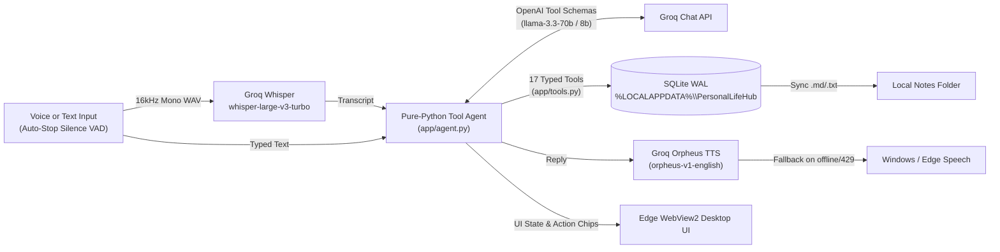

# Personal Life Hub

A **voice-first, pure-Python agentic desktop app** built with **FastAPI + Edge WebView2 (`pywebview`) + SQLite + Groq (Llama + Whisper + Orpheus TTS)** to capture tasks, 3-state checklists, lecture notes, gym sessions, art projects, and gaming logs in one fast local workspace.

> Designed to be genuinely useful every day — and clean, modular, and self-contained without LangChain or LangGraph bloat.

---

## System Architecture



---

## Key Features

- **🎙️ Voice-First Multi-Turn Agent (`Alt+V` / `Ctrl+Space`)**:
  - Speak naturally across multiple turns (*"I went to the gym and did squats 100kg 3x5, started a portrait WIP, and watched an ML lecture tagged AI, neural-nets"*) — the agent reads existing records and calls every required tool automatically.
  - **Mid-Lecture Note Appending**: Pause a lecture, tap Speak, and add concepts or `- [ ]` research-later items straight onto the active lecture note.
  - **Pure-Python RMS Silence Auto-Stop**: Automatically detects when you finish speaking and submits hands-free (with an optional **Continuous Loop** toggle).
  - **Smart TTS Replies**: Uses **Groq Orpheus** (`canopylabs/orpheus-v1-english`) with automatic fallback to built-in Windows/Edge speech, defaulting to **Questions & Clarifications Only** (configurable to *All Replies* or *Muted*).
- **✅ 3-State Tasks & Auto-Rollup Checklists**:
  - Every task supports **`not_started` (`○`)**, **`partially_completed` (`◐`)**, and **`completed` (`✓`)** states plus optional progress notes.
  - Tasks can contain nested checklist steps — checking `1..N-1` steps automatically sets the parent task to **`partially_completed`** with a progress bar; checking all steps completes it.
  - Separate **Daily Tasks** and **Want to Do / Someday** lists with 1-click promotion.
- **📝 Interactive Lecture Notes & Folder Sync**:
  - Supports tags, pinning, instant cross-app search, clickable `- [ ]` / `- [x]` Markdown checklists inside the editor, and safe synchronization with a local `.md`/`.txt` folder.
- **🏋️ Simple Gym Tracker**:
  - 1-click **"Went to Gym Today"** toggle, monthly consistency calendar, fast sets/reps/weight logger (auto-marks Gym Day), 1-click repeat last set, and Personal Best history — zero routine-builder clutter.
- **🎨 Simple Art & 🎮 Gaming Trackers**:
  - **Art**: **"Drew Today"** calendar, Ideas to Draw, WIP/Finished cards, and local reference image attachments with lightbox preview.
  - **Gaming**: `Playing`, `Want to Play`, `Finished`, and `On Hold` filter tabs, `1–10` ratings, platform badges, and session notes.

---

## Privacy & Data Isolation

All personal data stays outside this repository in:

```text
%LOCALAPPDATA%\PersonalLifeHub
├── lifehub.db        # SQLite WAL database
├── settings.json     # Groq API key & preferences
├── app.log           # Windowless startup diagnostics
└── media\            # Art reference images
```

---

## Quick Start

1. **Create virtual environment & install dependencies** (Python 3.13+):
   ```powershell
   py -3.13 -m venv .venv --system-site-packages
   .\.venv\Scripts\python.exe -m pip install -r requirements.txt
   ```
2. **Launch the desktop app**:
   - Double-click **`Start Personal Life Hub.vbs`** (windowless native Edge WebView2 launch), or run:
   ```powershell
   .\.venv\Scripts\python.exe run_app.py
   ```
3. **Configure Groq Free API**:
   - Open **⚙️ Settings** (`Alt+8`), paste your free API key from [Groq Console](https://console.groq.com/keys), click **Test Key**, and click **Save Settings**.
   - *(Everything also works offline via deterministic fallback heuristics if no key is configured.)*

---

## Keyboard Shortcuts

| Shortcut | Action |
| :--- | :--- |
| `Ctrl+K` | Focus top Quick-Capture / Agent input |
| `Alt+V` | Start or stop voice recording |
| `Ctrl+Space` | Start or stop voice recording (when not typing in a field) |
| `Esc` | Cancel active voice recording or close image modal |
| `Alt+1` .. `Alt+8` | Jump to Hub, Tasks, Notes, Gym, Art, Gaming, Voice Agent, or Settings |

---

## Running Tests & Verification

```powershell
.\.venv\Scripts\python.exe -m pytest -v
.\.venv\Scripts\python.exe run_app.py --smoke-test
```

For deeper technical details (agent loop, 17-tool catalog, SQLite ER schema, RMS VAD, and extending TTS with Google TTS), see [docs/ARCHITECTURE.md](docs/ARCHITECTURE.md).
