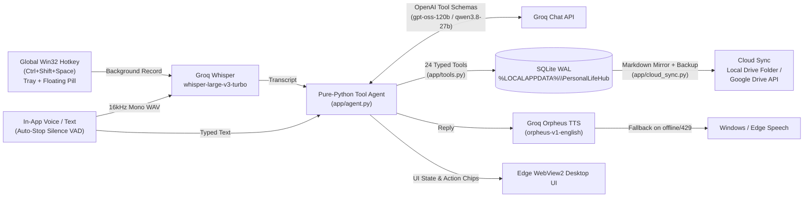

# Personal Life Hub

A **voice-first, pure-Python agentic desktop app** built with **FastAPI + Edge WebView2 (`pywebview`) + SQLite + Groq (`gpt-oss-120b` / `qwen3.8-27b` + Whisper + Orpheus TTS)** to capture tasks, 3-state checklists, lecture notes, focus sessions, playlists/watchlist links, gym sets, art projects, and gaming logs in one fast local workspace.

> Designed to be genuinely useful every day — and clean, modular, and self-contained without LangChain or LangGraph bloat.

---

## System Architecture



---

## Key Features

- **🎙️ Voice-First Multi-Turn Agent (`Alt+V` / `Ctrl+Space`)**:
  - Speak naturally across multiple turns (*"I went to the gym and did squats 100kg 3x5, started a portrait WIP, and watched an ML lecture tagged AI, neural-nets"*) — the agent reads existing records and calls every required tool automatically.
  - **Mid-Lecture Note Appending**: Pause a lecture, tap Speak, and add concepts or `- [ ]` research-later items straight onto the active lecture note.
  - **Pure-Python RMS Silence Auto-Stop**: Automatically detects when you finish speaking and submits hands-free (with an optional **Continuous Loop** toggle).
  - **Smart TTS Replies**: Uses **Groq Orpheus** (`canopylabs/orpheus-v1-english`) with automatic fallback to built-in Windows/Edge speech, defaulting to **Questions & Clarifications Only** (configurable to *All Replies* or *Muted*).
- **⌨️ System-Wide Global Hotkey (`Ctrl+Shift+Space`), Background Tray & Floating Pill**:
  - **Capture From Anywhere**: Press the customizable global hotkey (`Ctrl+Shift+Space` by default) while in another app or minimized to the system tray — no need to focus or open the window first.
  - **Background System Tray & Audio Chimes**: Closing the window hides cleanly to the Windows notification tray with right-click controls (**Open**, **Toggle Voice Recording**, **Exit**) and gentle start/stop/done/error `winsound` chimes.
  - **Non-Focus-Stealing Floating Pill**: A compact always-on-top Win32 indicator shows live recording duration and AI status without interrupting your active window.
- **✅ Two-Tab Tasks (`Tasks for Today` & `Tasks in General`), Progress Bars, Day Checkboxes & Connected Notes**:
  - **Tasks for Today vs. Tasks in General**: Dedicated **Tasks for Today** tab for today's actionable to-do list, separated cleanly from multi-day plans, daily habits, long-term projects, and collapsible Someday items inside **Tasks in General**.
  - **Countable Habits (`days`) vs. Non-Countable Goals (`percent`) vs. Step Checklists (`checklist`)**: Countable habits (e.g., *"LeetCode 1 hour a day for 10 days"*) render individual **Day 1 … Day N checkboxes**, while non-countable goals (e.g., *"Graduation project surveys"*) render an interactive **0–100% progress bar**, slider, `+10%` / `+25%` buttons, and timestamped **Progress Log** entries — switchable anytime on each card.
  - **Connected Task Notes (Bidirectional)**: Record progress notes directly on any task, auto-create or open its linked structured Markdown note (**`Open in Notes ↗`**), and jump back via **`✅ Task:`** chips inside the Notes view.
  - **Automatic Sub-Task Detection & 3-State Rollup**: Adding or completing a Today task automatically detects and links to its larger parent goal (asking when ambiguous), while **`not_started` (`○`)**, **`partially_completed` (`◐`)**, and **`completed` (`✓`)** roll up automatically from sub-items, days, or `0–100%` progress.
- **📝 Structured Markdown Notes, Notebooks & ✨ AI Organizer**:
  - **Read / Split / Edit Modes + Formatting Toolbar**: Render headings, callouts (`> [!NOTE]`, `> [!IMPORTANT]`), fenced code blocks, tables, highlighted text, links, and clickable `- [ ]` / `- [x]` checkboxes directly in preview.
  - **Notebooks & Filtering**: Organize notes into folders (`Lectures`, `Projects`, `Study`, `Personal`, `Ideas`, or custom notebooks), filter by pinned or `#tag`, search across summaries/titles/bodies, and sort by Updated, Created, or Title.
  - **✨ Organize with AI & Auto-Structured Voice Notes**: 1-click button (`Structured`, `Lecture Note`, `Concise TL;DR`) turns messy voice transcripts into crisp Markdown headings, bullets, summaries, tags, and follow-up checklists; Voice Agent also auto-structures dictated notes.
  - **Subfolder Sync**: Bidirectional synchronization with a local `.md`/`.txt` folder (mapping subfolders to note notebooks).
- **⏱️ Focus / Study Timer & Live Daily Study Totals (`Alt+4`)**:
  - **Live Counting Toward Today**: Every running focus timer (countdown or stopwatch) immediately counts toward **Study Today** totals across Timer, Hub, and Tasks views; starting a new timer automatically saves any prior active focus session, and hitting a daily habit's target minutes marks it **Done Today** automatically.
  - **Countdown / Pomodoro (`25/5`, `50/10`, `90/15`, or custom) & Open Stopwatch** with live top-bar timer pill, gentle WebAudio chime, and wall-clock/server sync that survives minimizing to tray.
  - **Tagging, Linking & Stats**: Categorize by subject, link sessions to any **Active Task** (or auto-match from topic) or **Note**, log past sessions manually, track streaks & 7-day charts, and control everything by voice.
- **📺 Watchlist & Playlists (`Alt+5`)**:
  - Save **playlists, videos, courses, podcasts, and articles** (`YouTube` oEmbed + safe HTML title auto-fill, SSRF-protected).
  - Track episode/lecture progress (`3/12` with automatic `to_watch` → `watching` → `watched` status rollup), open structured lecture notes in 1 click (`📝 Note`), and launch a linked **Focus Timer** (`⏱️ Study`) directly from any item.
- **☁️ Dual Cloud & Google Drive Sync (`Alt+0`)**:
  - **Option A — Instant Cloud Folder Auto-Sync**: Mirror organized `Notes/<Notebook>/*.md`, `Watchlist.md`, `Tasks.md`, and `lifehub-backup.json` automatically to **Google Drive Desktop**, **OneDrive**, or **Dropbox** (with Windows path auto-detection).
  - **Option B — Direct Google Drive API (`drive.file`)**: Connect with your own Google Cloud OAuth `credentials.json` stored strictly in `%LOCALAPPDATA%\PersonalLifeHub` to upload and update files directly in Drive without managing folders locally.
- **🏋️ Simple Gym Tracker**:
  - 1-click **"Went to Gym Today"** toggle, monthly consistency calendar, fast sets/reps/weight logger (auto-marks Gym Day), 1-click repeat last set, and Personal Best history — zero routine-builder clutter.
- **🎨 Simple Art & 🎮 Gaming Trackers**:
  - **Art**: **"Drew Today"** calendar, Ideas to Draw, WIP/Finished cards, and local reference image attachments with lightbox preview.
  - **Gaming**: `Playing`, `Want to Play`, `Finished`, and `On Hold` filter tabs, `1–10` ratings, platform badges, and session notes.

---

## Privacy & Data Isolation

All personal data stays outside this repository in:

```text
%LOCALAPPDATA%\PersonalLifeHub
├── lifehub.db                # SQLite WAL database
├── settings.json             # Groq API key, hotkey, tray & cloud preferences
├── google_credentials.json   # Optional Google Drive OAuth client config
├── google_token.json         # Optional Google Drive OAuth token
├── tray.ico                  # Generated Windows system tray icon
├── runtime.json              # Active desktop PID/port for single-instance focus
├── app.log                   # Windowless startup diagnostics
└── media\                    # Art reference images
```

---

## Quick Start

1. **Create virtual environment & install dependencies** (Python 3.13+):
   ```powershell
   py -3.13 -m venv .venv --system-site-packages
   .\.venv\Scripts\python.exe -m pip install -r requirements.txt
   ```
2. **Launch the desktop app**:
   - Double-click **`Start Personal Life Hub.vbs`** (windowless native Edge WebView2 launch), or run:
   ```powershell
   .\.venv\Scripts\python.exe run_app.py
   ```
3. **Configure Groq Free API**:
   - Open **⚙️ Settings** (`Alt+0`), paste your free API key from [Groq Console](https://console.groq.com/keys), click **Test Key**, and click **Save Settings**.
   - *(Everything also works offline via deterministic fallback heuristics if no key is configured.)*

---

## Keyboard Shortcuts

| Shortcut | Action |
| :--- | :--- |
| `Ctrl+Shift+Space` | **Global system-wide** toggle to start/stop voice capture (customizable in Settings) |
| `Ctrl+K` | Focus top Quick-Capture / Agent input |
| `Alt+V` | Start or stop voice recording |
| `Ctrl+Space` | Start or stop voice recording (when not typing in a field) |
| `Esc` | Cancel active voice recording or close image modal |
| `Ctrl+S` | Save current or new note (when in Notes view) |
| `Alt+1` .. `Alt+0` | Jump to Hub (`1`), Tasks (`2`), Notes (`3`), Focus Timer (`4`), Watchlist (`5`), Gym (`6`), Art (`7`), Gaming (`8`), Voice Agent (`9`), or Settings (`0`) |

---

## Running Tests & Verification

```powershell
.\.venv\Scripts\python.exe -m pytest -v
.\.venv\Scripts\python.exe run_app.py --smoke-test
```

For deeper technical details (agent loop, 24-tool catalog, SQLite ER schema, Win32 global hotkey/tray host, Cloud/Drive sync, RMS VAD, and extending TTS with Google TTS), see [docs/ARCHITECTURE.md](docs/ARCHITECTURE.md).
