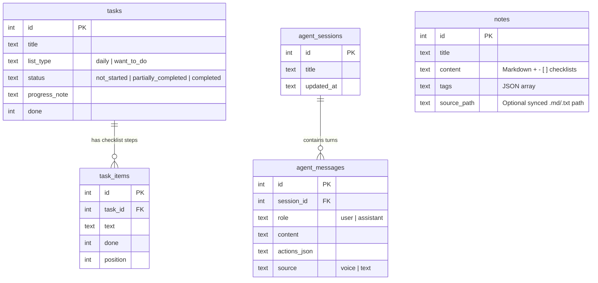

# Architecture & Technical Design

This document details how **Personal Life Hub** implements a voice-first, multi-turn tool-calling agent in pure Python without external orchestration frameworks.

---

## 1. Pure-Python Agent Loop vs. LangChain / LangGraph

Instead of pulling in LangChain/LangGraph abstractions, `app/agent.py` + `app/tools.py` run a focused, inspectable ~150-line tool-calling loop directly over Groq's OpenAI-compatible `/chat/completions` API:

1. **Session Context Assembly**: Loads the active session from `agent_sessions` and the last 12 `agent_messages`, injecting compact `[Executed actions: domain #id: label]` annotations onto prior assistant messages so follow-up voice turns (*"check off the first item on that lecture note"*) resolve exact database IDs across turns.
2. **Bounded Tool Loop (`MAX_TOOL_ROUNDS = 6`)**:
   - Sends messages + 17 JSON tool schemas (`tools.TOOL_SCHEMAS`) to `llama-3.3-70b-versatile` (falling back automatically to `llama-3.1-8b-instant` on HTTP `400`/`429`/`503`).
   - Executes returned `tool_calls` synchronously in `app/tools.py`, appends structured JSON results as `"tool"` messages, and collects UI badges (`action_badge`) and navigation triggers (`navigate_to`).
   - When the model returns a natural-language response, persists both the reply and action metadata into SQLite and returns `is_question` so the UI knows whether to speak clarifications aloud.
3. **Offline Fallback**: When no Groq key is present (or the network is unreachable), `_offline_agent_fallback` handles checklist task syntax (`steps: ...`), tagged lecture notes, gym sets, and quick captures cleanly.

---

## 2. Agent Tool Catalog (`app/tools.py`)

| Tool | Purpose |
| :--- | :--- |
| `get_today_overview` | Read today's gym/art status, open tasks, notes, and active games |
| `list_tasks` | Inspect tasks + nested checklist items filtered by list, status, or query |
| `create_task` | Create Daily or Want-to-Do task with optional `checklist_items` & status |
| `update_task` | Update title, priority, due date, `progress_note`, or 3-state `status` |
| `manage_task_checklist` | Add, check, uncheck, or remove sub-items with automatic parent rollup |
| `search_notes` | Search notes by keywords and `#tags` |
| `get_note` | Read full note content, tags, and Markdown checklist stats |
| `create_note` | Create a note with tags, Markdown `- [ ]` checklists, and optional disk sync |
| `append_to_note` | Append lecture remarks, research checklist items, or tags to an existing note |
| `update_note_checklist` | Toggle `- [ ]` / `- [x]` lines inside a note by substring match |
| `log_gym_day` | Mark a date on the Gym consistency calendar |
| `log_gym_exercise` | Log sets/reps/weight and automatically mark that date as a Gym Day |
| `get_gym_stats` | Retrieve recent workout logs and Personal Bests per exercise |
| `upsert_art` | Mark Art Day and/or create or update an Idea, WIP, or Finished piece |
| `upsert_game` | Create or update game status, platform, rating (`1–10`), and notes |
| `navigate_ui` | Switch the WebView2 desktop view (`hub`, `tasks`, `notes`, `gym`, `art`, `gaming`, `ask`, `settings`) |
| `delete_item` | Safely delete an item — requires `confirmed=true` after explicit user confirmation |

---

## 3. SQLite Schema & Legacy Migration (`app/db.py`)

Databases use `PRAGMA journal_mode=WAL` and `PRAGMA foreign_keys=ON`. `_migrate_db()` inspects `PRAGMA table_info(tasks)` on startup so older v0.1 databases automatically receive `status` and `progress_note` without data loss.

### 3-State Task Auto-Rollup
- `0` sub-items checked → `not_started`
- `1 .. N-1` sub-items checked → `partially_completed`
- `N / N` sub-items checked → `completed`

---

## 4. Voice Input & Pluggable TTS Pipeline

1. **Recording & Pure-Python RMS VAD (`app/voice.py`)**:
   - Captures `16kHz`, mono, 16-bit PCM via `sounddevice.RawInputStream` into an in-memory buffer capped at 120 seconds.
   - Computes per-chunk RMS in pure Python (`array('h')` + `math.sqrt` — no `numpy` dependency). Once sustained speech exceeds `SPEECH_RMS_THRESHOLD` (`450`) and drops below `SILENCE_RMS_THRESHOLD` (`220`) for `silence_seconds` (default `1.8s`), the callback sets `_auto_stopped = True` and raises `sounddevice.CallbackStop` safely without calling `stream.stop()` inside the PortAudio thread.
2. **Speech-to-Text**: Sends standard WAV bytes to Groq `whisper-large-v3-turbo` (`/openai/v1/audio/transcriptions`).
3. **Text-to-Speech (`app/tts.py`) & Extending with Google TTS**:
   - Primary provider calls Groq Orpheus (`canopylabs/orpheus-v1-english`, `response_format="wav"`).
   - Any missing key, rate limit (`429`), or network error returns `{"fallback_local": true}`, causing the UI to speak via `window.speechSynthesis`.
   - To add Google Cloud TTS or Gemini TTS later, implement `_synthesize_google_tts(text)` in `app/tts.py` returning WAV bytes and add a `google_api_key` setting in `app/config.py`.
